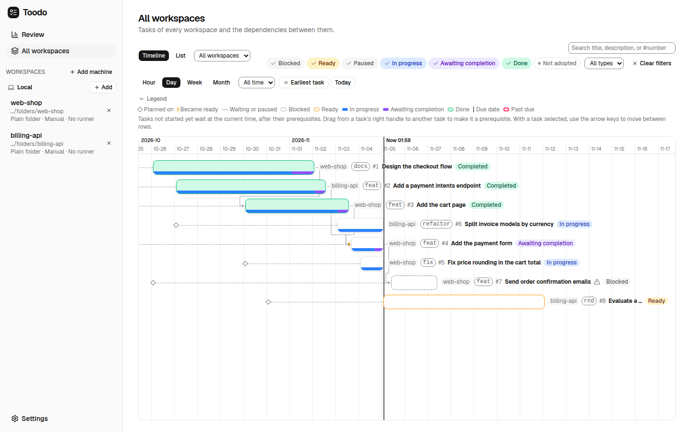
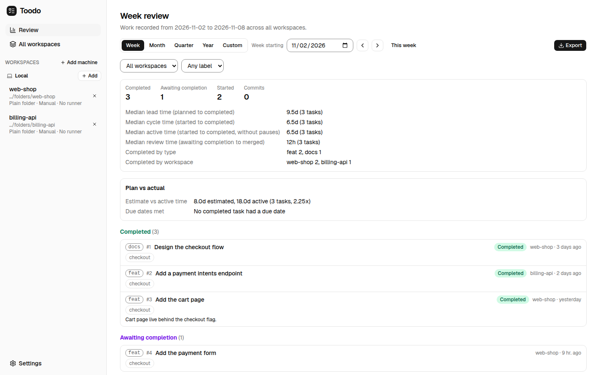

# Toodo

Toodo is a self-hosted task tracker for planned work, used by people and coding agents:
`toodo-server` runs on a Linux machine and you use it from a browser as an installable web
app (PWA), and agents use it over MCP. It keeps the dependencies between tasks as a DAG and
keeps the memory of the work: notes, decisions, references, and a timeline of when and why
each task was planned, started, reviewed, and completed, so the year's work can be
compiled into a performance report.

Toodo does not run the work. Whoever does it, a person or an executor such as Dori that
creates worktrees, runs agents, and opens pull requests, records the outcome in Toodo.

## Features

- **Workspaces**: group tasks by project; a workspace has a name, an optional description,
  and an optional repository reference such as `owner/repo`.
- **Planning**: create tasks per workspace; express ordering as dependencies (a DAG). A
  planned task is ready once every task it depends on is done; cycles are rejected.
- **Work memory**: progress, decision, and blocker notes on each task, a completion note,
  and references (`refs`) such as `lane:<key>`, `discord:<thread>`, `pr:<url>`, or a URL.
- **Reasons**: starting, pausing, and completing a task record why, next to the status
  change in its history.
- **Completion criteria**: `manual` items checked with evidence, and `url` items Toodo
  checks with an HTTP GET; completing a task makes its dependents ready.
- **Agent access (MCP)**: coding agents read and plan tasks, record starts, notes, and
  decisions, and complete tasks through the server's MCP endpoint; copy the client config
  from Agent access in Settings (the gear at the bottom of the sidebar). See
  [docs/agents.md](docs/agents.md).
- **Timeline**: every status change is timestamped; the dependency graph is drawn on a
  time axis showing when each task was planned, started, reviewed, and completed.
- **Review**: a report of what was planned, started, and completed in a period, built
  from that history; see [Review](#review).



## Getting Started

[docs/quickstart.md](docs/quickstart.md) goes from installing the server to a first
completed task, and [docs/troubleshooting.md](docs/troubleshooting.md) covers the errors
new setups run into most.

## Plan

**Plan** in the "All workspaces" view sums the estimates of tasks per quarter or year of
their due dates. Set a capacity per quarter and every period that holds more work than
it is highlighted as over capacity; tasks without an estimate or due date are listed so
you can fill them in. [docs/architecture.md](docs/architecture.md#plan-view) has the
rules.

## Review

**Review** in the sidebar reports the work recorded in a week, month, quarter, year, or a
custom range, across all workspaces or narrowed to one workspace or label. It is built only
from recorded facts: status changes and their reasons, decision notes, references, and the
completion notes you write. Commit and pull request figures recorded by earlier versions
still show in the periods they cover.

- A summary counts the tasks completed, awaiting completion, started, and planned; it
  gives the median lead, cycle, active, and review times and what was completed by type
  and by workspace.
- "Plan vs actual" compares estimates with active time and due dates with completion
  dates, when tasks have them; a year adds a "Year in review" section.
- Each task is listed once, under the most advanced milestone it reached in the period,
  with its references and completion note.
- Export copies the review as Markdown, saves it as Markdown or CSV, or prints it.

The review is the source for status updates and a year-end report.
[docs/architecture.md](docs/architecture.md#review) defines each number.



## Keyboard Shortcuts

The web app lists these with `?`. Letter shortcuts do nothing while you type in a field.

| Keys | Action |
| --- | --- |
| `Ctrl+K` / `Cmd+K` | Open the command palette: jump to a task by title or `#number`, or run an action such as opening a workspace, the review, or settings |
| `j` / `k` | Select the next or previous task in the list or on the timeline |
| `Enter` | Open the details of the selected task |
| `Esc` | Close the details, the palette, or a dialog |
| `/` | Search tasks |
| `?` | Show the shortcuts |
| `Up` / `Down` / `Home` / `End` | On a timeline bar, move the selection between rows |

## Documentation

- [docs/quickstart.md](docs/quickstart.md): from install to a first completed task.
- [docs/troubleshooting.md](docs/troubleshooting.md): common errors and what to do.
- [AGENTS.md](AGENTS.md): contributor and AI-agent guidelines, including the language policy.
- [docs/architecture.md](docs/architecture.md): domain model and system components.
- [docs/workflow.md](docs/workflow.md): task lifecycle from planning to completion.
- [docs/agents.md](docs/agents.md): using Toodo from coding agents, as an orchestrator or a
  worker, and where their instructions come from.
- [docs/server.md](docs/server.md): installing and running `toodo-server`, the web app, and
  its API.
- [docs/migrate-desktop-data.md](docs/migrate-desktop-data.md): moving the data of the former
  Windows desktop app into a `toodo-server`.

## Requirements

- A Linux machine for `toodo-server`: x64 or arm64 with glibc for the npm packages,
  x86_64 for the release archive
- A current browser to use the web app
- Optional: Claude Code (`claude`) or Codex (`codex`) on `PATH` when `toodo init` runs, to
  register the MCP endpoint with them

The recommended install, on Linux x64 or arm64 (glibc or musl) or macOS with Node.js 18 or
later:

```sh
npm i -g @dubusoft/toodo
toodo init
toodo service install
```

`toodo update` installs the newest version later and restarts the server on it. See
[Install with npm](docs/server.md#install-with-npm), and [docs/server.md](docs/server.md)
for installing without Node.js or from a checkout. Continue with
[docs/quickstart.md](docs/quickstart.md) to sign in and plan a first task.

## End-to-End Tests

`e2e/` holds Playwright tests that drive the web app against a
scratch `toodo-server`. Every test starts its own server on a free loopback port with a
temporary data directory, so a run never touches the data of a real server and never binds
the default server ports.
CI does not run it; run it locally before merging changes to the web app.

To run it locally (Node, Rust, and a Linux machine):

```sh
npm ci
npx playwright install chromium                       # once
(cd src-tauri && cargo build --bin toodo-server)
npx vite build
npm run test:e2e
```

Rebuild the server after Rust changes and the web app after frontend changes; the tests use
the last builds. Pass Playwright options after `--`, for example
`npm run test:e2e -- e2e/timeline.spec.ts --headed`. `TOODO_SERVER_BIN` points the tests at
another `toodo-server` binary and `TOODO_E2E_WEB_DIR` at another web build. After a failure,
`npx playwright show-report` opens the report.

## Tech Stack

Rust (tokio, axum) for `toodo-server`, React + TypeScript + React Flow for the web app,
SQLite. See [AGENTS.md](AGENTS.md#platform-and-stack) for details.

## Releases

A release ships `toodo-server` together with the web app; servers update with
`toodo update`, or without npm with `scripts/install-server.sh --release latest` (see
[docs/server.md](docs/server.md)).

To publish a release:

1. On `dev`, run `npm run bump <major|minor|patch|X.Y.Z>`. It sets the same version in
   `package.json`, `package-lock.json`, `src-tauri/Cargo.toml`, and
   `src-tauri/Cargo.lock`. Commit it as `Release X.Y.Z`. `npm run check-version` checks
   that the four files agree; the workflow runs it first.
2. Check that the npm packages install and start, on Linux x64 with Node.js and npm. Build
   both binaries with the release version and the web app, stage the packages, and run
   the smoke script on them:

   ```sh
   npm ci && npm run build
   (cd src-tauri && TOODO_VERSION=X.Y.Z cargo build --release --bin toodo --bin toodo-server)
   node scripts/package-npm.mjs --version X.Y.Z --web dist-web --out dist-npm \
     --binaries linux-x64=src-tauri/target/release
   node scripts/smoke-npm.mjs dist-npm
   ```

   `scripts/smoke-npm.mjs` serves the staged packages from a local registry, installs
   `@dubusoft/toodo` globally into a temporary prefix with npm, runs `toodo init` on a free
   loopback port with a temporary home and data directory, and checks that the server
   answers the API and serves the web app. It stops the server and removes the temporary
   directory afterwards (`--keep` leaves the directory). Fix what it reports before
   releasing.
3. Open a pull request from `dev` to `main` and merge it.
4. On every push to `main`, the `Release` workflow (`.github/workflows/release.yml`)
   releases the version in `package.json` unless it is already published: on Ubuntu it
   builds the web app (`npm run build`) and the x86_64 Linux `toodo-server`, packages
   them with `scripts/package-server.sh`, uploads
   `toodo-server-vX.Y.Z-linux-x86_64.tar.gz` and then its `.sha256`, and creates the
   release "Toodo vX.Y.Z" if it is missing. A push to `main` without a version bump does
   nothing.

Releases run from `main` rather than from tags so the Rust build cache of one release is
reused by the next. If a release fails, run the `Release` workflow by hand on `main`; it
completes a release whose server assets were not uploaded yet.

The `Release` workflow also starts the `npm` workflow on `main` with dist-tag `latest` to
publish the release to npm. If that publish fails or is skipped, run the `npm` workflow by
hand on `main` with dist-tag `latest`. Every push to `dev` publishes an `X.Y.Z-dev.N`
prerelease under `dev`; see [npm Packages](docs/server.md#npm-packages).

## Language Policy

All repository content (docs, code, comments, commits, PRs) is written in English.

## Contributing

Outside contributions are accepted under the [Contributor License Agreement](CLA.md).
See [`CONTRIBUTING.md`](CONTRIBUTING.md) for how to sign it in a pull request.

## Sponsoring

If Toodo is useful to you, you can support its development through
[GitHub Sponsors](https://github.com/sponsors/dev-bokdong).

## License

Copyright (C) 2026 dev-bokdong

Toodo is licensed under the [GNU Affero General Public License v3.0 only](LICENSE)
(`AGPL-3.0-only`). If you run a modified Toodo for users over a network, the AGPL requires
you to offer those users the source of your modified version.

Versions released before this license change, up to and including v1.3.1, were released
under the MIT License and remain available under it. Releases after v1.3.1 are
`AGPL-3.0-only`.
