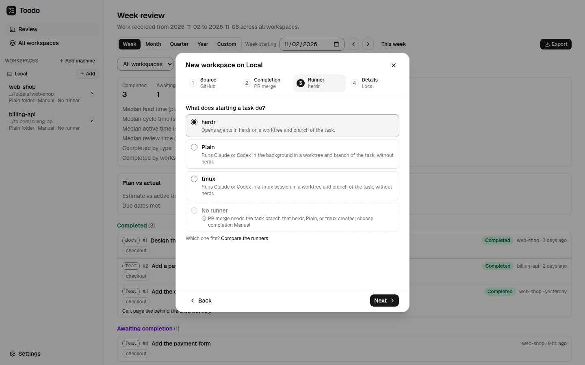
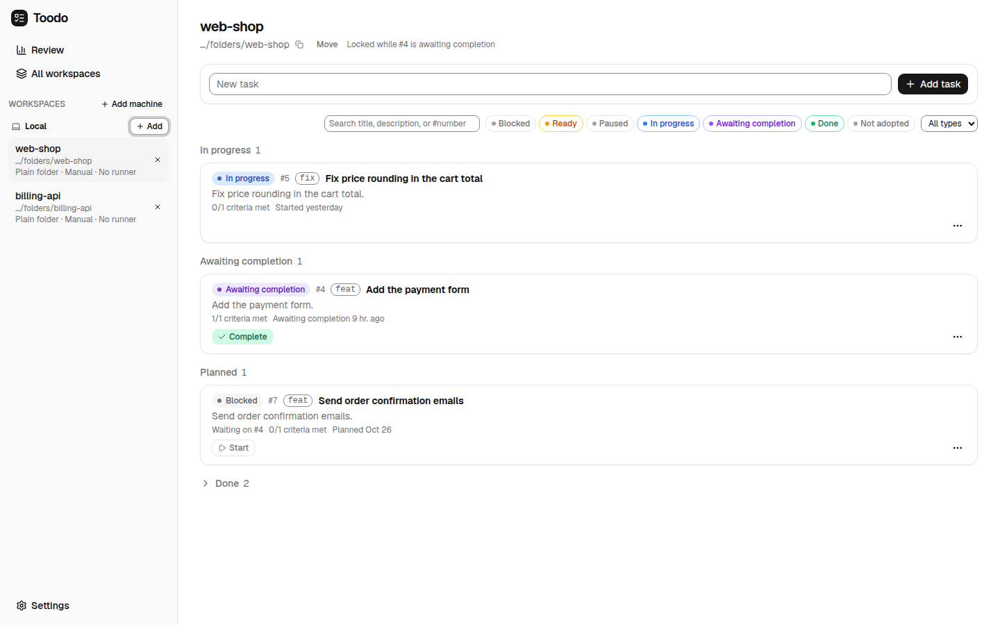

# Quickstart

From installing Toodo to a first task whose pull request is merged, on one Linux machine.
It uses a GitHub repository you already cloned there and runner Plain, which needs no
herdr. Plan on about 15 minutes plus the time the agent takes.

## 1. Check the Prerequisites

On the Linux machine that will run the server (x64 or arm64, glibc):

- Node.js 18 or later with npm.
- Git and OpenSSH (`ssh`) on `PATH`.
- The GitHub CLI, logged in as the user that will run the server: `gh auth login`, then
  `gh auth status` shows the account.
- `claude` (Claude Code) or `codex` on `PATH`, logged in, for the agent that implements
  the task.
- A clone of a GitHub repository you can push to, e.g. `~/src/my-app`.

herdr is optional; see [runners.md](runners.md) for when it is worth installing.

## 2. Install and Start the Server

```sh
npm i -g @dubusoft/toodo
toodo init
toodo service install
```

`toodo init` creates the data directory (`~/.local/share/toodo-server` by default),
starts the server on `127.0.0.1:47616`, and registers its MCP endpoint with Claude Code
and Codex where they are installed. It prints the web app URL and the file that holds the
web access token. `toodo service install` keeps the server running as the systemd user
service `toodo-server.service`, also after a reboot. `toodo status` shows whether it runs.

## 3. Sign In

Open `http://127.0.0.1:47616` in a browser on the same machine. To use the app from
another device, put the server behind a tunnel first; see
[Off the Machine](server.md#off-the-machine-cloudflare-tunnel-and-access) in
`docs/server.md`.

The sign-in form asks for the access token. Print it on the server and paste it:

```sh
cat ~/.local/share/toodo-server/web-token
```

The browser then gets a device token of its own, which Settings > Devices lists. Settings
> Runners shows which of herdr, tmux, `claude`, and `codex` the server found.

## 4. Add the Repository as a Workspace

Select **+ Add** beside "Local" in the sidebar. The dialog asks four questions in order:

1. **Source**: GitHub, with "Open existing" (the folder already holds the clone).
2. **Completion**: PR merge, so a task is done once its pull request is merged.
3. **Runner**: Plain. The default is herdr while herdr runs on the server; the
   "Compare the runners" link under the choices opens [runners.md](runners.md).
4. **Details**: the folder of the clone, e.g. `/home/me/src/my-app`, a name, and the
   base branch that pull requests go into (left empty, the branch `origin/HEAD` points
   to).

Select **Open workspace**. The workspace appears in the sidebar with its source,
completion, and runner.



## 5. Set the Worktree Root

Every task gets its own git worktree, created under the worktree root of the machine.
Open the workspace; above its tasks, "Worktree root on Local" asks for a directory, e.g.
`/home/me/worktrees`. Save it once per machine.

## 6. Plan a Task

Type a title in **New task** at the top of the workspace, e.g. "Add a health check
endpoint", and expand the form to add a type, a description, and criteria. The
description is what the agent reads, so say what the outcome is and why. The criterion
"Pull request merged into the base branch" comes first by default. Select **Add task**.

To make one task wait for another, pick the prerequisite in "Add dependency..." in the
task's details, or on the timeline drag from the prerequisite's right handle to the task
that waits for it. A
task can start only once every task it depends on is done.



## 7. Start the Task and Run the Agent

Select **Start** on the task. Toodo creates the task branch from the latest base on
`origin` and checks it out in a worktree under the worktree root; the task is now
`in_progress`.

Open the task's details. Under Runs, pick Claude or Codex and select **Start run**. The
agent works in the worktree with the task's title, description, and criteria as its
prompt; the run streams its output and its todo list into the app. Ask it to commit its
work. Start another run with follow-up instructions if it needs more.

With runner herdr instead, select **Open in herdr** and work with the agent in herdr's
panes.

## 8. Open the Pull Request

When the commits are ready, select **Open PR** on the task. Toodo pushes the branch and
opens a pull request into the base branch, titled and described from the task. The task
moves to `in_review`, shown as "Awaiting completion". If the agent opened the pull
request itself, Toodo finds it within a minute and records it the same way. After review
feedback, **Push to PR** pushes new commits.

## 9. Merge It

Review and merge the pull request on GitHub. Toodo checks the pull requests of tasks in
review once a minute: within about a minute of the merge, the task is `done`, its
commits and pull request are recorded, and every task that depended on it can start.

That is the whole loop. Next:

- The **Review** page in the sidebar reports what was planned, started, and completed in
  a week, month, quarter, or year; see "Review" in the [README](../README.md#review).
- [agents.md](agents.md) shows how a coding agent can plan tasks and start workers
  through Toodo's MCP tools.
- [troubleshooting.md](troubleshooting.md) covers the errors new setups run into most.
- [workflow.md](workflow.md) describes every step of the task lifecycle in detail.
